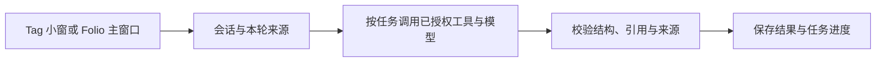

# Folio — Collect. Connect. Curate.

Folio 把散落的链接和文字整理成可以回看、串联和继续写的个人展览。Tag 是 Folio 的桌面伙伴，陪你读网页、看视频、看文章、留下收藏、找回以前读过的资料。

https://github.com/user-attachments/assets/276a3aa9-d76f-43b5-8148-08c5501dbb5f

[Web 在线体验](https://101.34.60.121/folio-demo/try/) · [Mac 本地安装（GitHub 源码）](#在-macos-上使用-tag)

- **Web 在线体验**：打开即用，无需注册或配置模型。可以浏览 41 条示例收藏和 5 场展览，试用「收新」里的示例文字整理，也可以在手记里写想法、加图片、保存摘录并回到出处。网页版没有独立悬浮的桌面小助手，也不支持窗口吸附。网页内的 Tag 只识别示例库链接。手记和阅读偏好保存在当前浏览器。
- **Mac 本地安装**：从 GitHub 下载源码，在 macOS 13 或更新版本上本地编译。Tag 可以吸附窗口、读取所选浏览器页面。个人收藏、对话和手记保存在本机。只想看示例时，可以使用无需配置模型的演示模式。 也可以让 Codex 等 Coding Agent 帮忙安装和接入模型。[查看可复制指令](#在-macos-上使用-tag)
- **接入模型**：在 Mac 个人模式使用模型问答时，请在本机 Folio 填写服务商提供的 **Chat Completions 兼容 API 地址、准确的模型名称和对应的 API Key**。API Key 只在本机 Folio 填写。问答所需的内容会发送给你选择的模型服务。

[产品设计](#产品设计) · [Agent 设计](#agent-设计) · [Harness 设计](#harness-设计) · [记忆设计](#记忆设计)

本仓库包含 Web 工作台、macOS 客户端源码和可在本机打开的示例展览。

以下设计以 macOS 个人模式为例。

## 产品设计

读到一篇值得留存的文章时，可以先用 Tag 问正文，再把文章收进 Folio。下次查同一个问题，Folio 会从已收藏的原文中找相关段落。多篇资料能共同解释一个事件或问题时，可以组织成展览。阅读时留下的摘录和想法，日后可以从手记回到出处。

| 设计决策 | 在产品中的体现 |
| --- | --- |
| **Collect · 保留来源** | 收藏保留原链接和可取得的正文。支持的视频在字幕可用时可保存字幕，读取不到内容时仍可保留链接。 |
| **Connect · 从原文找关联** | 搜索收藏或查看相似收藏时，可以打开命中的原文段落。阅读收藏时，可以在解读、原文和通俗读法间切换。 |
| **Curate · 围绕问题组织展览** | 同一问题的首展至少需要三篇去重原文、两个独立来源，并要求材料提供新增信息。展览可以从速览、来源对照或脉络深读切入。 |
| **继续写 · 让手记连回出处** | 收藏或展览中的文字片段和图片可以收进「思考手记」，补上自己的想法，回看时可跳回出处。 |

[专题筛选](desktop/server/curation-clusters.mjs) · [阅读摘录](site/curator/reading-note-capture.js)

## Agent 设计

Tag 小窗和 Folio 主窗口共用同一套 Agent 服务和会话记录，各自保留当前会话选择与草稿。浏览器换页时，可以跟随新页，也可以留在正在聊的页面。成功建立的页面会话在 24 小时内可以自动恢复，过期的会话仍可从历史打开。

| 入口 | 本轮可用的资料 | 结果 |
| --- | --- | --- |
| Tag 当前页对话 | 所选浏览器窗口里，经用户操作读取的正文或选区 | 围绕当前页问答、预览原文，或通过收藏动作保存 |
| Tag 或主窗口里的资料问答 | 本轮选中的收藏，以及问题需要时召回的相关收藏 | 给出答复，附可核对的收藏引用 |
| 主窗口里的整理与策展 | 已保存的原文、来源版本和当前任务条件 | 生成收藏解读或展览读稿，显示处理进度和可重试状态 |

[Agent 服务](desktop/server/service.mjs) · [页面会话](desktop/server/harness/page-sessions.mjs)

## Harness 设计

Harness 由本机服务负责。一次需要模型的任务会先确定会话和资料范围，再执行允许的工具与模型调用。结果通过校验后保存，界面显示进度、引用和失败原因。



| 部分 | 实现与边界 |
| --- | --- |
| 上下文与记忆 | 根据任务选取当前会话、明确保存的偏好和来源证据，受上下文容量限制。 |
| 工具与执行流程 | `read-page` 按用户动作读取选定来源。`web-search` 启用后处理用户要求的公开搜索。收藏和策展通过各自的任务流程执行。 |
| 运行、安全与隐私 | 任务状态写入本机。失败后重试时复用仍有效的步骤。取消和超时后丢弃迟到结果。页面正文作为来源数据处理，模型问答会将选定内容发给配置的模型服务。 |
| 评测 | 使用合成资料和注入模型覆盖会话、引用、权限、取消与恢复。真实模型回答与展览读稿的质量另行验收。 |

[工具注册](desktop/server/harness/skills.mjs) · [任务运行器](desktop/server/harness/runtime.mjs) · [任务评测](scripts/eval-harness.mjs) · [记忆与 Skill 评测](scripts/eval-memory-skills.mjs)

## 记忆设计

| 信息 | 保存和使用方式 |
| --- | --- |
| 原始会话 | 持久保留历史消息和来源，供用户回看。 |
| 近期对话 | 本轮最多带入同一会话最近 20 个完整用户轮次，并受输入容量限制。 |
| 会话工作记忆 | 用较早消息的带出处摘录保留当前目标、已知决定和待澄清问题。 |
| 跨会话回忆 | 问到过去的讨论时按需检索原对话并带回出处。向量提供方可用时结合词法和语义匹配，向量不可用时使用词法检索。 |
| 用户偏好 | 通过设置或「记住」「忘记」显式管理，带版本和撤销记录，可在不同会话中复用有效偏好。 |

收藏原文和段落索引属于资料库，用于定位证据。任务检查点记录执行进度，供重试时恢复。

[上下文构建](desktop/server/harness/context.mjs) · [记忆实现](desktop/server/harness/memory.mjs)

## 在浏览器里体验

安装 Node.js 22 和 npm 后，在源码目录执行：

```sh
npm ci
npm run dev
```

打开 [http://127.0.0.1:4176/](http://127.0.0.1:4176/)。首次访问打开一个空白工作台，未配置模型时也可保存文字草稿。浏览器保存本机记录，清理站点数据后会丢失。

要在浏览器中查看预置演示馆，运行 `npm run desktop:server`，打开终端显示的本机地址并使用已填好的演示账号登录。此入口使用本机示例资料，包含 41 条收藏和 5 场展览。

要用自己的模型，先运行 `cp .env.example .env`。在 `.env` 中配置 `ZHIPU_CODING_API_KEY`、模型名和至少 32 字符的随机 `FORME_SESSION_SECRET`。文本接口示例使用智谱的标准 API。请使用该 API 的应用凭据，并将模型名改为账号可用的模型。只用本地内存账本时，将 `FORME_WORKER_URL` 留空。配置与访问的服务地址都只在 Node 进程生效。启用图片理解需单独提供对应视觉模型的凭据。

如需本地持久额度或异步采集，给应用和 Worker 配置同一个至少 32 字符的随机 `FORME_WORKER_TOKEN`，将应用的 `FORME_WORKER_URL` 设为 `http://127.0.0.1:8790`。另开终端执行 `npm run worker`，保持与 `npm run dev` 同时运行。外部视频采集还有平台可达性及可选的 yt-dlp、FFmpeg、转写运行时要求。

公开运行 Web 体验需要 HTTPS、共享额度账本、服务端模型密钥与独立的部署数据目录。部署说明见 [deploy/README.md](deploy/README.md)。

## 在 macOS 上使用 Tag

可以把下面的指令复制给 Codex 等 Coding Agent。先把方括号里的内容换成你要用的模型服务商和模型名称。

```text
请帮我在这台 Mac 上从 https://github.com/tomanojerry-debug/folio-demo 安装并启动 Folio，接入 [模型服务商] 的 [模型名称]。
请确认兼容 Chat Completions 的 API 地址和准确的模型名称，并打开 Folio 的模型设置页。
API Key 由我本人在本机 Folio 填写。请勿索取、读取、记录或传输 API Key，也不要泄露本机的私人信息。
```

在 Mac 上从 GitHub 拉取源码并本地编译。需要 macOS 13 或更新版本、Node.js 22 和带 Git、Swift 的 Xcode Command Line Tools。若还未安装命令行工具，在终端运行 `xcode-select --install`。

```sh
git clone https://github.com/tomanojerry-debug/folio-demo.git
cd folio-demo
npm ci
npm run desktop -- --personal --setup-model
```

首次运行会编译并打开 Folio。按页面提示填写支持 Chat Completions 的 API 地址、模型名称和自己的 API Key。连接成功后即可和 Tag 对话。之后在源码目录再次运行 `npm run desktop -- --personal --setup-model` 即可启动，模型配置会保留在本机。Key 保存在仅本机用户可读取的配置文件中。模型问答会把相关内容发送给你选择的模型服务。

只想浏览示例时，从 Folio 菜单退出后运行 `npm run desktop`。演示馆包含预置收藏和展览，无需模型，数据写入 `.data/folio-demo/`。

开发者也可通过 `npm run desktop -- --personal` 使用本地 `.env` 配置。源码启动的个人收藏、对话和笔记保存在 `.data/desktop/`。默认本机语义索引会在首次使用时下载公开模型，可在 `.env` 中设置 `KNOWLEDGE_EMBEDDING_BACKEND=disabled` 使用全文检索。

桌面联网搜索默认关闭。要启用，在本机 `.env` 中设置 `ZHIPU_WEB_SEARCH_MCP_URL` 和独立的 `ZHIPU_WEB_SEARCH_API_KEY`，使用具备智谱联网搜索 MCP 权限的凭据。

Tag 的原生窗口识别和浏览器协作可能需要 macOS 授权。

## 项目结构

| 目录 | 内容 |
| --- | --- |
| `site/` | Web 体验和桌面 Web 界面 |
| `server/`、`api/` | 模型适配、收藏理解、策展、Web API |
| `worker/` | 持久额度、请求缓存和可选的来源采集 |
| `desktop/` | Tag 的 Swift 外壳、本机服务和资料存储 |
| `tests/` | 使用测试替身或合成资料的运行测试 |

```sh
npm test
npm run check
```

Folio 自有代码和原创示例采用 [MIT 许可证](LICENSE)。第三方组件与馆藏作品适用各自的许可。见 [第三方来源与许可](THIRD_PARTY_NOTICES.md)。
